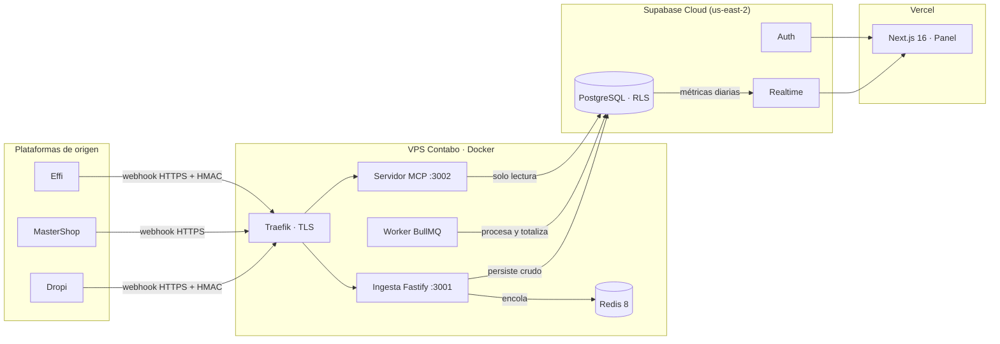

# Perfil técnico y de seguridad · Integración con Dropi

Documento para el equipo técnico y de seguridad de **Dropi**. Describe cómo está
construida Miru-Ecommerce, sus estándares, su superficie de integración y lo que
necesitamos de su lado para autorizar la conexión por API.

Fecha: 19-nov-2026 · Versión: 1.0

---

## 1. Resumen ejecutivo

Miru-Ecommerce es una plataforma SaaS de **gestión centralizada de pedidos,
garantías, transportadoras y finanzas** para operaciones de dropshipping en Colombia.
Recibe pedidos de canales de venta y marketplaces, calcula el fee del 5 % y entrega
al negocio un panel operativo y financiero en tiempo real.

Para Dropi ofrecemos **dos modos de conexión por API**:

1. **Push (recomendado si Dropi emite webhooks):** Dropi envía eventos de pedido a
   un endpoint HTTPS de Miru, firmados con HMAC-SHA256.
2. **Pull (si Dropi solo expone REST):** Miru consulta periódicamente los pedidos con
   credenciales de **solo lectura** y un rango de fechas explícito.

En ambos casos Miru **no modifica** información en Dropi: únicamente lee pedidos,
estados y datos logísticos. No creamos pedidos en su plataforma sin un acuerdo
explícito y un alcance escrito.

---

## 2. Titular y contacto

| Campo               | Valor                         |
| ------------------- | ----------------------------- |
| Razón social        | _(completar antes de enviar)_ |
| NIT                 | _(completar)_                 |
| Domicilio           | _(completar)_                 |
| Representante legal | _(completar)_                 |
| Contacto técnico    | _(nombre, correo, teléfono)_  |
| Horario de soporte  | _(zona horaria y horario)_    |

---

## 3. Arquitectura



**Separación de responsabilidades**

| Componente    | Función                                                                   | Dónde vive     |
| ------------- | ------------------------------------------------------------------------- | -------------- |
| WebApp        | Panel de operadores (Next.js)                                             | Vercel         |
| Ingesta       | Recibe webhooks, valida firma, persiste crudo y encola                    | VPS Docker     |
| Worker        | Procesa eventos, aplica reglas de orden e idempotencia, refresca métricas | VPS Docker     |
| Base de datos | Pedidos, ítems, garantías, finanzas, auditoría, RLS                       | Supabase Cloud |
| MCP           | Consulta de solo lectura para agentes/herramientas                        | VPS Docker     |
| Proxy         | TLS, enrutamiento y límites de tamaño                                     | Traefik (VPS)  |

---

## 4. Stack y versiones

| Capa               | Tecnología                       | Versión         |
| ------------------ | -------------------------------- | --------------- |
| Runtime            | Node.js                          | 22.22.2 (LTS)   |
| Lenguaje           | TypeScript                       | 5.9.3           |
| Gestor de paquetes | pnpm (monorepo)                  | 11.28.5         |
| Panel              | Next.js (App Router) + React     | 16.4.6 / 19.3.1 |
| API de ingesta     | Fastify                          | 5.12.8          |
| Cola               | BullMQ + ioredis                 | 6.7.7 / 6.0.0   |
| Persistencia       | PostgreSQL (Supabase) + RLS      | 15+             |
| Caché/cola         | Redis                            | 8               |
| Autenticación      | Supabase Auth (cookies httpOnly) | —               |
| SDK MCP            | @modelcontextprotocol/sdk        | 1.32.2          |
| Contenedores       | Docker + Compose                 | 29 / v5         |
| Sistema del VPS    | Ubuntu                           | 24.04 LTS       |

**Calidad**

- **121 pruebas automatizadas** (43 dominio compartido, 17 ingesta, 19 worker,
  31 web, 11 MCP).
- Typecheck y lint obligatorios en cada build; despliegue desde `main` con revisión.
- Contrato de datos con **Zod** compartido entre ingesta y worker.

---

## 5. Modelo de datos (resumen)

| Tabla                     | Contenido                                                  | Aislamiento |
| ------------------------- | ---------------------------------------------------------- | ----------- |
| `tenants`                 | Negocios                                                   | —           |
| `tenant_members`          | Usuarios y rol (owner/operador)                            | RLS         |
| `connections`             | Canales (Dropi, MasterShop, Effi) y su estado              | RLS         |
| `webhook_events`          | Evento crudo + estado de procesamiento (auditoría 14 días) | RLS         |
| `orders`                  | Pedido: estado, cliente, transportadora, guía, totales     | RLS         |
| `order_items`             | Ítems y **fee Miru 5 % generado por la BD**                | RLS         |
| `products`                | Catálogo, stock, costos                                    | RLS         |
| `warranties`              | Garantías por estado                                       | RLS         |
| `dashboard_metrics_daily` | Métricas agregadas por día (Realtime)                      | RLS         |

**Reglas de dinero**

- Todos los montos son **enteros en centavos** (`BIGINT`). No se usa `float` en
  ninguna capa.
- El fee del 5 % lo calcula **la base de datos** (columna generada por ítem y trigger
  de totalización); la aplicación **no lo recalcula**.
- La utilidad se deriva del fee de pedidos entregados menos el de devueltos.

---

## 6. Superficie de integración

### 6.1 Endpoint de webhooks Miru v1

```
POST https://api.miruecommerce.pro/webhooks/miru/v1/<connection_id>
Content-Type: application/json
x-miru-signature: sha256=<HMAC-SHA256 del body crudo con el secreto del canal>
x-miru-timestamp: <segundos Unix>
```

| Aspecto                | Valor                                                                 |
| ---------------------- | --------------------------------------------------------------------- |
| Autenticación          | HMAC-SHA256 sobre el **body crudo** (no sobre JSON re-serializado)    |
| Ventana de tiempo      | ±5 minutos                                                            |
| Idempotencia           | `unique(connection_id, external_event_id)`; reenvío → `200 duplicate` |
| Orden                  | Solo se aplica si `external_updated_at` entrante > almacenado         |
| ACK                    | `200 accepted` en **< 500 ms**; el trabajo pesado va a la cola        |
| Tamaño máximo          | 1 MiB                                                                 |
| Límite de abuso        | 120 peticiones/minuto por IP → `429` con `retry-after`                |
| Persistencia           | El crudo se guarda **antes** de procesar (auditoría)                  |
| Retención de auditoría | 14 días                                                               |

**Códigos de respuesta**

| Código | Significado                          |
| ------ | ------------------------------------ |
| 200    | `accepted` o `duplicate` (entregado) |
| 400    | JSON inválido                        |
| 401    | Firma o timestamp inválidos          |
| 404    | `connection_id` desconocido          |
| 422    | Payload fuera de contrato            |
| 429    | Límite de peticiones                 |
| 503    | Cola no disponible (reintentar)      |

**Payload** (ejemplo completo en el anexo A): `event_id`, `event_type`,
`occurred_at` y `order` con `external_id`, `status`, `external_created_at`,
`external_updated_at`, `carrier`, `tracking_number`, `customer`
(`name`, `phone`, `city`, `address`), `shipping_cost_cents`, `gateway_fee_cents`
e `items[]` (`sku`, `qty`, `unit_price_cents`, `unit_cost_cents`).

Estados aceptados: `pendiente`, `confirmado`, `en_transito`, `entregado`,
`devuelto`, `cancelado`, `novedad`.

### 6.2 Modo pull (si Dropi solo expone REST)

Si Dropi no emite webhooks, Miru puede consultar su API:

| Requisito    | Detalle                                                |
| ------------ | ------------------------------------------------------ |
| Credenciales | API key o token de **solo lectura**                    |
| Consulta     | Pedidos por rango de fechas + paginación               |
| Frecuencia   | 5–15 minutos (configurable, acorde a sus límites)      |
| Ventana      | Solapamiento de 24 h para no perder cambios            |
| Egress IP    | `86.48.30.152` (para su allowlist, si aplica)          |
| Escritura    | **Ninguna**; Miru no crea ni modifica pedidos en Dropi |

### 6.3 Servidor MCP (opcional)

`https://api.miruecommerce.pro/mcp` (Streamable HTTP, token Bearer) expone consultas
de **solo lectura**: pedidos, detalle, stock, garantías y resumen financiero. Es una
alternativa para herramientas internas, no un requisito de la integración.

---

## 7. Seguridad

| Control                 | Implementación                                                                       |
| ----------------------- | ------------------------------------------------------------------------------------ |
| Transporte              | TLS 1.2+ en panel y API; certificados Let's Encrypt                                  |
| Autenticación del panel | Supabase Auth; sesión en cookies httpOnly; roles owner/operador                      |
| Autorización de datos   | **RLS en todas las tablas**; cada negocio ve solo sus filas                          |
| Secretos                | `service_role` y HMAC solo en servidor (variables de entorno); nunca en el navegador |
| Firma de webhooks       | HMAC-SHA256 + ventana de 5 minutos                                                   |
| Idempotencia            | Índice único por conexión y evento                                                   |
| Integridad de orden     | Regla `external_updated_at` monotónica                                               |
| Límite de entrada       | 1 MiB por request; 120 req/min por IP                                                |
| Auditoría               | Evento crudo persistido antes de procesar (14 días)                                  |
| Multi-tenant            | Funciones `SECURITY DEFINER` para comprobaciones de pertenencia                      |
| Cifrado en reposo       | A cargo del proveedor de base de datos (Supabase)                                    |
| Registro                | Logs de ingesta (requests, errores), worker (`process_error`) y healthcheck          |
| Respaldos               | Exportación lógica diaria (script desplegado; activación con la cadena de conexión)  |
| Dependencias            | Versiones fijadas por lockfile; sin escaneo automatizado de vulnerabilidades         |

### 7.1 Limitaciones que declaramos

Para que su evaluación no tenga sorpresas:

- **No contamos con SOC 2, ISO 27001 ni PCI DSS.** No procesamos pagos; no
  almacenamos datos de tarjetas.
- **Sin SLA contractual formal**; operamos con objetivo de disponibilidad y respuesta
  de soporte en horario hábil.
- **Sin WAF/SIEM dedicados**; el perímetro se apoya en el proxy, el límite por IP y
  el control de acceso.
- **Sin prueba de penetración externa** a la fecha.
- **Residencia de datos:** base en `us-east-2` (EE. UU.); VPS en la ubicación del plan
  contratado. Si su política exige residencia en Colombia, lo evaluamos.
- **Monitoreo externo** con uptime sintético: en implementación (hoy hay healthcheck
  interno cada 15 minutos).

---

## 8. Operación

| Aspecto                | Estado                                                          |
| ---------------------- | --------------------------------------------------------------- |
| Despliegue             | GitHub `main` → Vercel (panel) y Docker Compose (VPS)           |
| Reinicio automático    | `restart: unless-stopped` en todos los contenedores             |
| Healthchecks           | `/health` de la API y `healthcheck.sh` cada 15 minutos          |
| Purga de eventos       | Automática a los 14 días (worker)                               |
| Keep-alive de BD       | Tarea diaria (evita la pausa del plan gratuito)                 |
| Respaldos              | `pg_dump` diario con retención de 7 días (activación pendiente) |
| Registro de incidentes | Contacto técnico directo; respuesta objetivo < 24 h hábiles     |

---

## 9. Datos personales tratados

| Dato                 | Uso                            | Retención                 |
| -------------------- | ------------------------------ | ------------------------- |
| Nombre del comprador | Operación y soporte del pedido | Mientras exista la cuenta |
| Teléfono             | Contacto de entrega            | Mientras exista la cuenta |
| Ciudad y dirección   | Logística de entrega           | Mientras exista la cuenta |
| Correo del operador  | Acceso al panel                | Mientras exista la cuenta |

No se envían datos personales a servicios de IA. No se comparten con terceros salvo
los proveedores de infraestructura necesarios (Vercel, Supabase, Contabo).

---

## 10. Cómo se conectaría Dropi (flujo propuesto)

1. **Revisión** de este documento y de la especificación del contrato (anexo A).
2. **Modo:** definir push (webhooks) o pull (REST).
3. **Credenciales:**
   - Push: Miru entrega `connection_id` + secreto HMAC por canal privado.
   - Pull: Dropi entrega API key de solo lectura y documentación de su API.
4. **Sandbox:** prueba con un pedido de prueba y el vector de firma del anexo B.
5. **Producción:** se activa el canal, se monitorean los primeros eventos y se
   documenta el contacto de guardia.

### Qué necesitamos de Dropi

| Dato                                                        | Motivo                                      |
| ----------------------------------------------------------- | ------------------------------------------- |
| Documentación de API (endpoints, auth, paginación, límites) | Diseñar el mapeo real, sin suponer campos   |
| ¿Emiten webhooks? ¿Con firma?                               | Elegir push o pull                          |
| Credenciales de sandbox                                     | Validar antes de producción                 |
| Catálogo de estados y su significado                        | Traducir a los estados de Miru              |
| Un pedido de ejemplo (JSON)                                 | Verificar estructura y montos               |
| Límites de tasa y ventana de datos                          | Ajustar frecuencia y no afectar su servicio |
| Contacto técnico y horario                                  | Incidentes                                  |

### Qué entregamos

- URL del webhook por canal y secreto HMAC (medio privado).
- Contrato, ejemplo de payload y vector de firma.
- Logs de eventos aceptados/rechazados y acompañamiento en la primera prueba.
- Documento de esta ficha y canal de soporte técnico.

---

## 11. Cuestionario de seguridad (respuestas rápidas)

| Pregunta típica                     | Respuesta                                                          |
| ----------------------------------- | ------------------------------------------------------------------ |
| ¿Dónde se aloja la aplicación?      | Vercel (panel) + VPS Contabo (ingesta/worker/MCP) + Supabase Cloud |
| ¿Cifrado en tránsito?               | Sí, TLS 1.2+ en todos los endpoints                                |
| ¿Cifrado en reposo?                 | Sí, a cargo de Supabase                                            |
| ¿Cómo se autentican los usuarios?   | Supabase Auth, sesión httpOnly, roles                              |
| ¿Aislamiento entre clientes?        | RLS en todas las tablas                                            |
| ¿Cómo se autentican los webhooks?   | HMAC-SHA256 + timestamp ±5 min                                     |
| ¿Los reintentos duplican pedidos?   | No: idempotencia por evento                                        |
| ¿Qué pasa si llega un evento viejo? | Se descarta por regla de orden                                     |
| ¿Retención de eventos crudos?       | 14 días                                                            |
| ¿Quién accede a producción?         | Solo el owner del proyecto; sin accesos compartidos                |
| ¿Respaldos?                         | Exportación diaria (retención 7 días)                              |
| ¿Certificaciones?                   | Ninguna (SOC 2 / ISO 27001 no disponibles)                         |
| ¿Pruebas de penetración?            | No realizadas                                                      |
| ¿Se procesan pagos?                 | No; solo datos de pedido y logística                               |

---

## 12. Checklist para la autorización de Dropi

- [ ] Dropi revisó arquitectura, stack y controles de seguridad.
- [ ] Se acordó el modo: push (webhooks) o pull (REST).
- [ ] Dropi entregó documentación, sandbox y catálogo de estados.
- [ ] Se validó el mapeo con un pedido real de prueba.
- [ ] Se definieron contactos técnicos y horario de incidentes.
- [ ] Se acordó el tratamiento de datos personales y la retención.
- [ ] Se documentó la fecha de activación en producción.

---

## Anexo A · Payload canónico

```json
{
  "event_id": "evt-ejemplo-0001",
  "event_type": "order.upserted",
  "occurred_at": "2026-11-19T09:15:00-05:00",
  "order": {
    "external_id": "DP-1001",
    "status": "confirmado",
    "external_created_at": "2026-11-19T08:40:00-05:00",
    "external_updated_at": "2026-11-19T09:10:00-05:00",
    "carrier": "Coordinadora",
    "tracking_number": "CO-994120581",
    "customer": {
      "name": "Camila Restrepo",
      "phone": "3105550142",
      "city": "Medellín",
      "address": "Cra 43 # 10-25"
    },
    "shipping_cost_cents": 1450000,
    "gateway_fee_cents": 0,
    "items": [
      { "sku": "LAMP-LED-01", "qty": 2, "unit_price_cents": 8400000, "unit_cost_cents": 5000000 }
    ]
  }
}
```

## Anexo B · Vector de firma

| Entrada | Valor                                                                     |
| ------- | ------------------------------------------------------------------------- |
| Body    | JSON del anexo A (567 bytes UTF-8)                                        |
| Secreto | `test-secret`                                                             |
| Firma   | `sha256=faed6806b262f98ceafa5a79b2c88170009e39f15c7eb0db8d4414f56cdad3ce` |

## Anexo C · Verificación

```bash
curl -s https://api.miruecommerce.pro/health   # {"ok":true}
curl -sI https://miruecommerce.pro/login       # 200, TLS
```
